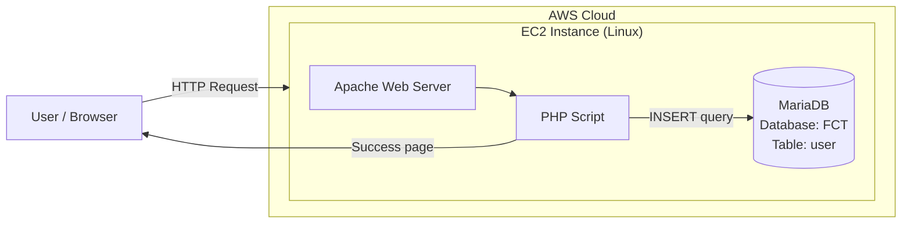

# PHP Signup Form with MariaDB on AWS


## 📌 Introduction

This project is a **Signup Form** built with **HTML + PHP** and backed by a **MariaDB** database. When a user submits the form, the data is validated by PHP, inserted into the `user` table of the `FCT` database, and a confirmation page shows the submitted information.

The project demonstrates deploying a basic web application on a cloud server (AWS EC2) with a web server and a database.

**Tech stack:** AWS EC2 · Apache/HTTPD · PHP · MariaDB · HTML · Git & GitHub

## 📖 Background

Web applications almost always need to collect user data and store it permanently. This project was created as a hands-on practice of:

- Launching and configuring an EC2 instance on AWS
- Installing a LAMP-style stack (Linux, Apache, MariaDB, PHP)
- Connecting PHP to a database and running `INSERT` queries
- Version-controlling the code with Git and publishing it on GitHub

## 🏗️ Architecture Diagram



**Flow:**
1. User opens the signup form in the browser (EC2 public IP).
2. User fills the form and clicks **Submit**.
3. Apache passes the request to the PHP script.
4. PHP connects to MariaDB and inserts the record into the `user` table.
5. A "New record created successfully" page is shown with the submitted data.

## 🗄️ Database Structure

Database: `FCT` | Table: `user`

| Field   | Type         | Null | Key | Extra          |
|---------|--------------|------|-----|----------------|
| id      | int(11)      | NO   | PRI | auto_increment |
| name    | varchar(50)  | YES  |     |                |
| email   | varchar(100) | YES  |     |                |
| website | varchar(200) | YES  |     |                |
| comment | varchar(500) | YES  |     |                |
| gender  | varchar(50)  | YES  |     |                |

## ⌨️ Input

The user enters the following details in the signup form:

| Field   | Example Value         |
|---------|-----------------------|
| Name    | Your Name             |
| Email   | example@gmail.com     |
| Website | https://cloud         |
| Comment | aws_project           |
| Gender  | Male / Female / Other |


## 📤 Output

After clicking **Submit**:

- A success page displays **"New record created successfully"** along with the submitted information (Name, Email, Website, Comment, Gender).
- The same record is stored in the MariaDB `user` table.


**Database verification:**

```sql
USE FCT;
DESC user;
SELECT * FROM user;
```


## ⚙️ Setup (Quick Steps)

```bash
# Install packages
sudo yum install -y httpd php php-mysqlnd mariadb-server

# Start services
sudo systemctl enable --now httpd mariadb

# Create database and table
mysql -u root -p
CREATE DATABASE FCT;
USE FCT;
CREATE TABLE user (
  id INT(11) NOT NULL AUTO_INCREMENT PRIMARY KEY,
  name VARCHAR(50),
  email VARCHAR(100),
  website VARCHAR(200),
  comment VARCHAR(500),
  gender VARCHAR(50)
);

# Place the project files in the web root
sudo cp -r * /var/www/html/
```

Then open `http://<EC2-PUBLIC-IP>/` in your browser.

## ✅ Conclusion

This project successfully demonstrates an end-to-end flow: a user submits data through a web form hosted on an AWS EC2 instance, PHP processes it, and MariaDB stores it permanently. It helped me understand cloud deployment, web server and database configuration, and Git/GitHub workflow.

**Future improvements:**
- Add input validation and sanitization (prepared statements to prevent SQL injection)
- Use AWS RDS for the database instead of a local MariaDB
- Add HTTPS with an SSL certificate
- Automate deployment with CI/CD (GitHub Actions)

## 👤 Author

**Tushar Thorat** — Cloud / DevOps Engineer
